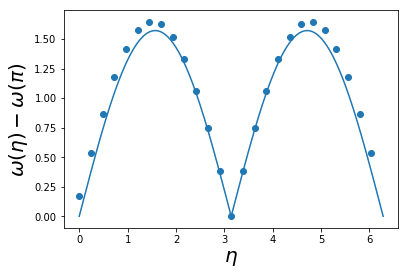
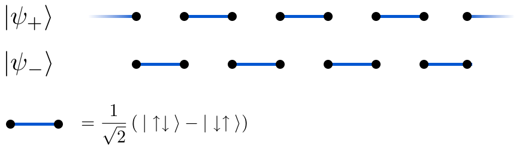
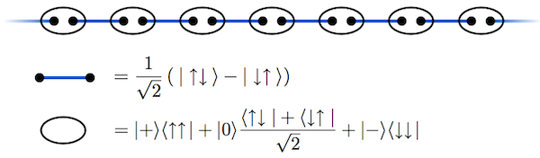



# Introduction

On 6th October 2026 OpenAI released 719 preprints containing mathematical results obtained by frontier AI model across a broad range of mathematics. Among the mathematical physics results was a [proof of the Haldane conjecture](https://github.com/openai/math/blob/main/preprints/The-periodic-spin-one-Haldane-gap-September-24-2026/paper.pdf), an important result in many-body physics dating from 1981[^1]. This conjecture states that the antiferromagnetic ($J>0$) Heisenberg chain is gapless for half integer spin and gapped for integer spin. The OpenAI result concerns the spin-1 case: see the introduction to their paper for a review of rigorous results obtained over the years.

[^1]: Haldane's 1981 preprint [@haldane2016ground] was apparently rejected for publication and then lost for many years, see his Nobel lecture from 2016 [@haldane2017nobel].

Some commentaries have now appeared on the Haldane gap work. See [Hal Tasaki](https://haltasaki.github.io/writings/AI/OpenAI_Haldane.html) (recommended), [Meng Cheng](https://www.overleaf.com/project/6ac5c7972379cb285bc961c3). See also [this Facebook group](https://www.facebook.com/groups/288854938128878). Note that Tasaki also provides a discrete time version of the transfer matrix that sidesteps the tricky functional analysis of the original version. This might be a better target for formalization.

# Proof outline

The purpose of this section is to outline the strategy of the OpenAI proof, identifying the required mathematical structures in order to survey the territory. The model under consideration is the spin-1 Heisenberg ferromagnet with periodic boundary conditions, described by the Hamiltonian

$$
H_L = \sum_{j=0}^{L-1} \sum_{\alpha=x,y,z} S^\alpha_j S^\alpha_{j+1}, \qquad S^\alpha_L = S^\alpha_0,
$$

where $S^\alpha_j$ is the $\alpha$ component of a spin 1 acting on site $j$. The energy gap $\gamma_L$ is defined as

$$
\gamma_L = E_1(L) - E_0(L)
$$

where $E_0(L)$ is ground state energy of a chain of length $L$ and $E_1(L)$ is the next distinct energy. The energy gap in the thermodynamic limit is defined as

$$
\Delta_1 = \liminf_{\substack{L \to \infty \\ L \text{ even}}} \gamma_L
$$

Thus the goal is to prove $\Delta_1 > 0$, which is achieved by proving some $L$ independent lower bounds on $\gamma_L$ for $L \geq 60$.

OpenAI

References: Tasaki book

Outline

1. Reminder: the idea of a gap
2. The Majumdar--Ghosh model
2. Haldane conjecture: integer and half integer are different!
3. AKLT
4. What about the spin-1 chain? 

$$
H = J \sum_{j=1}^N \mathbf{s}_j \cdot \mathbf{s}_{j+1},
$$

Dispersion relation

Incidentally, the Bethe ansatz solution of the spin-1/2 Heisenberg chain yields dispersion relation for the lowest excited state of momentum $\eta$ (__des Cloizeaux--Pearson__ dispersion)

$$
\omega_{\text{dCP}}(\eta) = \frac{\pi J}{2}\left|\sin(\eta)\right|,
$$ {#eq-dcp}

::: {#fig-gs-energy}

The ground state energy of the Heisenberg chain for $L=26$ as a function of $\eta$, compared with the des Cloiseaux--Pearson dispersion @eq-dcp.

:::

## Another example: Majumdar--Ghosh model

What else can happen in a spin-1/2 chain? There is another possibility: the ground state can be degenerate. The [Majumdar--Ghosh model](https://en.wikipedia.org/wiki/Majumdar%E2%80%93Ghosh_model) has an exact ground state that nicely illustrates this possibility. Its Hamiltonian adds next nearest neighbour couplings to the Heisenberg chain
$$
H_\text{MG} = J \sum_{j=1}^N \mathbf{s}_j \cdot \mathbf{s}_{j+1} + \frac{J}{2} \sum_{j=1}^N \mathbf{s}_j \cdot \mathbf{s}_{j+2}.
$$

The strength of these new couplings has been chosen carefully so that the model can be written (up to an overall constant)

$$
H_\text{MG} = \frac{J}{4} \sum_{j=1}^N \left[\mathbf{s}_{j-1} + \mathbf{s}_{j} + \mathbf{s}_{j+1}\right]^2.
$$

Each term in the Hamiltonian involves the sum of three spins. By the usual angular momentum addition rules, the spin quantum number for such a sum can be 3/2, 1, or 1/2. Thus the lowest energy occurs when any three consecutive spins add to make $S=1/2$. Since the $S=1/2$ space is of dimension $2S+1=2$, there are two linearly independent ways to do this. This leads to the following two degenerate ground states

How do we handle finite size?

## Lieb--Schultz--Mattis theorem

The Majumdar--Ghosh model shows that a spin-1/2 chain can have a degenerate ground state. The Heisenberg chain shows that it can be gapless. The Lieb--Schultz--Mattis (LSM) theorem @lieb1961two says that, for half-integer spin, these are the only options: _a translationally invariant half-integer spin chain cannot have a unique ground state with a gap_. We follow the version of the argument given by @affleck1986proof, applied to the Heisenberg chain of $N$ (even) spins with periodic boundary conditions,

$$
H = J\sum_{j=1}^N \mathbf{s}_j\cdot\mathbf{s}_{j+1},\qquad \mathbf{s}_{j+N} = \mathbf{s}_j.
$$

The argument only uses translation invariance, short-range interactions, and conservation of $S^z = \sum_j s^z_j$, so it applies much more widely. Suppose the ground state $\ket{0}$ is unique. It is then a singlet, so $S^z\ket{0}=0$, and it is an eigenstate of the translation operator $T$, with $T\mathbf{s}_jT^{-1} = \mathbf{s}_{j+1}$.

**The twist.** Consider the unitary

$$
U = \exp\left(\frac{2\pi i}{N}\sum_{j=1}^N j\, s^z_j\right),
$$

which rotates the spin on site $j$ about the $z$-axis by an angle $2\pi j/N$. The twist through $2\pi$ is spread over the whole chain, so neighbouring spins are rotated by only $2\pi/N$ relative to each other.

To see how operators transform under this unitary rotation, recall the __Hadamard lemma__

$$
e^{A}Be^{-A} = B + [A,B] + \frac{1}{2!}[A,[A,B]] + \frac{1}{3!}[A,[A,[A,B]]] + \cdots
$$

Applying the lemma with $[s^z_j, s^\pm_j] = \pm s^\pm_j$ gives $U s^\pm_j U^\dagger = e^{\pm 2\pi i j/N}s^\pm_j$, while $s^z_j$ is unchanged. The transformed Hamiltonian is then

$$
H' = UHU^\dagger = J\sum_{j=1}^N\left[\frac{1}{2}\left(e^{-2\pi i/N}s^+_js^-_{j+1} + e^{2\pi i/N}s^-_js^+_{j+1}\right) + s^z_js^z_{j+1}\right].
$$

The boundary bond from site $N$ to site $1$ gets the same phase, because $e^{2\pi i N/N}=1$: this is why the twist must total exactly $2\pi$.

**Orthogonality.** Next we show that $U^\dagger\ket{0}$ is orthogonal to $\ket{0}$. Translating the twist gives

$$
TUT^{-1} = \exp\left(\frac{2\pi i}{N}\sum_{j=1}^N j\, s^z_{j+1}\right) = U\, e^{-2\pi i S^z/N}\, e^{2\pi i s^z_1}.
$$

Here $e^{2\pi i s^z_1}$, a $2\pi$ rotation of a single spin, is $(-1)^{2s}$ times the identity. Since $\ket{0}$ is translationally invariant and has $S^z=0$,

$$
\braket{0}{U}{0} = \braket{0}{TUT^{-1}}{0} = (-1)^{2s}\braket{0}{U}{0}.
$$

For half-integer $s$, it follows that $\braket{0}{U}{0}=0$. Equivalently, $U\ket{0}$ has momentum shifted by $\pi$ relative to $\ket{0}$.

**Variational bound.** $U^\dagger\ket{0}$ is orthogonal to the ground state, so its energy is an upper bound on $E_1$:

$$
E_1 - E_0 \leq \braket{0}{H'}{0} - \braket{0}{H}{0} = \frac{J}{2}\sum_{j=1}^N\left\langle\left(e^{-2\pi i/N}-1\right)s^+_js^-_{j+1} + \left(e^{2\pi i/N}-1\right)s^-_js^+_{j+1}\right\rangle.
$$

Reflection symmetry $j\to -j$ gives $\langle s^+_js^-_{j+1}\rangle = \langle s^-_js^+_{j+1}\rangle$. Using that, and then translation and spin-rotation invariance,

$$
E_1 - E_0 \leq J\left(1-\cos\frac{2\pi}{N}\right)\cdot\frac{2N}{3}\abs{\langle \mathbf{s}_j\cdot\mathbf{s}_{j+1}\rangle} \simeq \frac{4\pi^2 J}{3N}\abs{\langle \mathbf{s}_j\cdot\mathbf{s}_{j+1}\rangle} \to 0.
$$

The intuition is that the twist costs energy $\sim(2\pi/N)^2$ on each of $N$ bonds. So either the ground state is degenerate (as in Majumdar--Ghosh), or there are excitations with energy $O(1/N)$ (as in Heisenberg).

The argument fails at exactly one step for integer spin: $(-1)^{2s}=+1$, and $U^\dagger\ket{0}$ need not be orthogonal to $\ket{0}$. This leaves room for a unique gapped ground state. The AKLT model shows that this really happens.

## Haldane conjecture

Try to state sharply. Why did he think this?

## The AKLT model

The Affleck--Kennedy--Lieb--Tasaki (AKLT) model @affleck1988valence is a spin-1 chain that, like the Majumdar--Ghosh model, has an exact ground state. Again, its Hamiltonian is a special modifcation of the Heisenberg spin chain [^biquad]

[^biquad]: Note that the biquadratic piece (the second term) doesn't bring anything new for spin-1/2, as it can be expressed in terms of the original Hamiltonian.

$$
H_\text{AKLT} = J \sum_{j=1}^N \mathbf{s}_j \cdot \mathbf{s}_{j+1} + \frac{J}{3} \sum_{j=1}^N \left(\mathbf{s}_j \cdot \mathbf{s}_{j+1}\right)^2.
$$

Again, the relative magnitude of the two terms has been carefully chosen, in this case so that the Hamiltonian may be put in the form (up to a constant)

$$
H_\text{AKLT} = 2J \sum_{j=1}^N P^{(2)}_{j,j+1},
$$ {#eq-aklt-proj}

where $P^{(2)}_{j,j+1}$ projects two neighbouring spins on to the subspace of total spin-2. 

::: {.callout-tip}
## Check

Show this. The key is to consider the sum of the two neighbouring spins $\mathbf{s}_j + \mathbf{s}_{j+1}$, which may have $S=2,1$, or $0$, so that

$$
\left(\mathbf{s}_j + \mathbf{s}_{j+1}\right)^2 = S(S+1) = 6, 2, 0.
$$

This means that the combination $\left(\mathbf{s}_j + \mathbf{s}_{j+1}\right)^4 - 2\left(\mathbf{s}_j + \mathbf{s}_{j+1}\right)^2$ gives zero on the spin-0 and spin-1 subspaces, projecting onto spin-2.

:::

Frustration freeness... definition

To understand the ground state of the AKLT chain, it's useful to imagine that the spin-1 $\mathbf{s}_j$ on each site is comprised of two spin-1/2: $s_{j,L/R}$. The ground state is then constructed in two steps. First, we create singlets between neighbouring sites: that is, between $\mathbf{s}_{j,R}$ and $\mathbf{s}_{j+1,L}$, and between $\mathbf{s}_{j,L}$ and $\mathbf{s}_{j-1,R}$. Note that this is just the same as one of the Majumdar--Ghosh ground states. Next, we project each pair $\mathbf{s}_{j,L/R}$ onto spin-1. 

::: {#fig-aklt-state}

Schematic construction of the AKLT ground state in terms of a pair of spin-1/2 at each site. Source: [Wikipedia](https://en.wikipedia.org/wiki/AKLT_model).

:::

Why does this yield the (unique) ground state of the model? Recall that the Hamiltonian @eq-aklt-proj is written in terms of spin-2 projectors for neighbouring sites. We will show that the above construction has no component in the spin-2 subspace for each pair of neighbouring spins, and so vanishes when the projection operator is applied. 

The two spin-1s correspond two four spin-1/2s in the above picture. The wavefunction of four spin-1/2s in the usual basis is $\Psi_{l_1 r_1 l_2 r_2}$ where each of the indices can be $\uparrow$ or $\downarrow$. There are $2^4=16$ components, as expected. 

A spin-2 state is a _totally symmetric_ wavefunction: the easiest way to see this is to note that $l_1=r_1=l_2=r_2=\uparrow$ corresponds to $S^z_\text{tot}=s^z_{l_1}+s^z_{r_1}+s^z_{l_2}+s^z_{r_2}=2$. This must be a $S_\text{tot}=2$ state (four spin-1/2 can make at most $S=2$). The remaining 4 states in the multiplet may be found by applying $S^-_\text{tot}$.  

::: {.callout-tip}
## Check

The symmetric states $\Psi_{s_1\cdots s_N}=\Psi_{(s_1\cdots s_N)}$ of $N$ spin-1/2s are the $S_\text{tot}=N/2$ states. There span a subspace of dimension $N+1=2S_\text{tot}+1$, as they should.

:::

Now it's easy to see why the AKLT construction works. The full wavefunction of the chain $\Psi_{\cdots l_j r_j l_{j+1} r_{j+1}\dots}$ must be antisymmetric in the $r_j$, $l_{j+1}$ indices and symmetric in the $l_j$, $r_j$ indices

$$
\Psi_{\cdots l_j r_j l_{j+1} r_{j+1}\cdots} = \Psi_{\cdots l_j [r_j l_{j+1}] r_{j+1}\cdots}=\Psi_{\cdots (l_j r_j) l_{j+1} r_{j+1}\cdots} = \Psi_{\cdots l_j r_j (l_{j+1} r_{j+1})\cdots}.
$$

$P^{(2)}_{j,j+1}$ acts by symmetrizing over $l_j$, $r_j$, $l_{j+1}$, and $r_{j+1}$, and this must give zero.

Generalizations to higher dimensions??

### Matrix product state

The two-step construction translates directly into a compact formula for the wavefunction. Write the projection of $(l_j, r_j)$ onto the spin-1 state $m_j\in\{+,0,-\}$ as a $2\times 2$ matrix $C^{m}_{l r}$:

$$
C^+ = \begin{pmatrix} 1 & 0 \\ 0 & 0 \end{pmatrix},\qquad
C^0 = \frac{1}{\sqrt{2}}\begin{pmatrix} 0 & 1 \\ 1 & 0 \end{pmatrix},\qquad
C^- = \begin{pmatrix} 0 & 0 \\ 0 & 1 \end{pmatrix},
$$

and the singlet between $r_j$ and $l_{j+1}$ as $\epsilon_{r l}$, with $\epsilon = \begin{pmatrix} 0 & 1 \\ -1 & 0 \end{pmatrix}$ (up to normalization). Summing over all the spin-1/2 indices then turns the chain of contractions into a product of matrices. For periodic boundary conditions this gives

$$
\Psi_{m_1 m_2\cdots m_N} = \operatorname{Tr}\left[A^{m_1}A^{m_2}\cdots A^{m_N}\right],\qquad A^m \propto C^m\epsilon,
$$ {#eq-aklt-mps}

and explicitly

$$
A^+ = \sqrt{\tfrac{2}{3}}\,\sigma^+,\qquad A^0 = -\frac{1}{\sqrt{3}}\,\sigma^z,\qquad A^- = -\sqrt{\tfrac{2}{3}}\,\sigma^-,
$$

where the factors are chosen so that $\sum_m A^m A^{m\dagger} = \mathbb{1}$. A state of this form is called a _matrix product state_ (MPS). The internal $2\times 2$ index, the _bond dimension_, is the spin-1/2 that is shared out in a singlet between neighbouring sites. Even though the Hilbert space has dimension $3^N$, the whole state is fixed by just three $2\times 2$ matrices. With open boundary conditions the trace is replaced by boundary vectors $u^\dagger A^{m_1}\cdots A^{m_N} v$. The free choice of $u$ and $v$ gives a four-fold degenerate ground state, corresponding to the unpaired spin-1/2 left at each end of the chain.

### Spin correlations

The MPS form makes expectation values easy to compute. Since the $A^m$ are real, the norm of the state is

$$
\inner{\Psi}{\Psi} = \sum_{m_1\cdots m_N} \operatorname{Tr}\left[A^{m_1}\cdots A^{m_N}\right]\operatorname{Tr}\left[A^{m_1}\cdots A^{m_N}\right] = \operatorname{Tr}\left[\cE^N\right],
$$

where the $4\times 4$ _transfer matrix_ is

$$
\cE = \sum_m A^m \otimes A^m.
$$

The sum over each physical index $m_j$ is done once, leaving a product of transfer matrices acting on the two bond indices (one from the ket, one from the bra). We can just as well regard $\cE$ as a linear map on $2\times 2$ matrices $X$, $\cE(X) = \sum_m A^m X A^{m\dagger}$. Using $\sigma^+ X\sigma^- + \sigma^- X \sigma^+ = \frac{1}{2}\left(\sigma^x X \sigma^x + \sigma^y X\sigma^y\right)$, this is

$$
\cE(X) = \frac{1}{3}\sum_{a=x,y,z} \sigma^a X \sigma^a.
$$

The eigenvalues follow immediately from $\sum_a \sigma^a\sigma^b\sigma^a = -\sigma^b$:

$$
\cE(\mathbb{1}) = \mathbb{1},\qquad \cE(\sigma^b) = -\frac{1}{3}\sigma^b.
$$

So $\cE$ has a unique largest eigenvalue $1$ and a three-fold degenerate eigenvalue $-1/3$. These correspond to the singlet and triplet in the decomposition $\frac{1}{2}\otimes\frac{1}{2} = 0\oplus 1$ of the two bond indices. In particular, $\inner{\Psi}{\Psi} = 1 + 3(-1/3)^N \to 1$ as $N\to\infty$.

To include an operator $O$ at site $j$, we replace the transfer matrix there by $\cE_O(X) = \sum_{m,m'} O_{mm'} A^{m'} X A^{m\dagger}$. For $S^z$ (eigenvalues $m=\pm1, 0$),

$$
\cE_{S^z}(X) = \frac{2}{3}\left(\sigma^+ X\sigma^- - \sigma^- X\sigma^+\right),\qquad \cE_{S^z}(\mathbb{1}) = \frac{2}{3}\sigma^z,\quad \cE_{S^z}(\sigma^z) = -\frac{2}{3}\mathbb{1}.
$$

In the limit $N\to\infty$ the remaining $\cE^{N-r-1}$ projects onto the leading eigenvector $\mathbb{1}$, with the trace $\frac{1}{2}\operatorname{Tr}[\cdots]$ closing the chain. Then for $r\geq 1$

$$
\langle S^z_0 S^z_r\rangle = \frac{1}{2}\operatorname{Tr}\left[\cE_{S^z}\left(\cE^{r-1}\left(\cE_{S^z}(\mathbb{1})\right)\right)\right] = \frac{1}{2}\operatorname{Tr}\left[\cE_{S^z}\left(\frac{2}{3}\left(-\frac{1}{3}\right)^{r-1}\sigma^z\right)\right] = \frac{4}{3}\left(-\frac{1}{3}\right)^r.
$$ {#eq-aklt-corr}

By $SU(2)$ symmetry the same holds for the $x$ and $y$ components. The correlations are antiferromagnetic but decay exponentially, $\abs{\langle S^z_0 S^z_r\rangle}\propto e^{-r/\xi}$, with correlation length

$$
\xi = \frac{1}{\log 3} \approx 0.91.
$$

The correlation length is set by the ratio of the second largest eigenvalue of the transfer matrix to the largest. This is a general feature of MPS with a unique leading eigenvalue: correlations always decay exponentially. Compare this with the spin-1/2 Heisenberg chain, where correlations decay as a power law. That is what we expect for a gapless system. Exponential decay is consistent with a gapped ground state, but it doesn't prove the gap. We still have to show this separately.

::: {.callout-tip}
## Check

Show that @eq-aklt-corr gives the energy per bond: $\langle \mathbf{s}_j\cdot\mathbf{s}_{j+1}\rangle = -4/3$. Use the transfer matrix to find $\langle (\mathbf{s}_j\cdot\mathbf{s}_{j+1})^2\rangle$ and check that $\langle H_\text{AKLT}\rangle$ agrees with the ground state energy $-2J/3$ per bond. This is the value for which $P^{(2)}_{j,j+1}$ has zero expectation.

:::

### Energy Gap

The AKLT ground state is exact, but its excitations are not. We can still get an upper bound on the dispersion relation, following Feynman and Bijl's treatment of excitations in superfluid helium. We take as a variational state for an excitation of momentum $k$

$$
\ket{k} = S^z_k\ket{\Psi},\qquad S^z_k = \sum_j e^{ikj} S^z_j.
$$

For $k\neq 0$ this is orthogonal to the ground state, since it has a different momentum. It is also a spin-1 state, because $\ket{\Psi}$ is a singlet. So its energy gives an upper bound on the lowest triplet excitation at momentum $k$:

$$
\epsilon(k) \leq \frac{\braket{\Psi}{S^z_{-k}\left(H - E_0\right)S^z_k}{\Psi}}{\braket{\Psi}{S^z_{-k}S^z_k}{\Psi}} \equiv \frac{f(k)}{s(k)}.
$$ {#eq-feynman-bijl}

The denominator is the _static structure factor_. Per site, it is the Fourier transform of the correlation function we just found:

$$
s(k) = \frac{1}{N}\braket{\Psi}{S^z_{-k}S^z_k}{\Psi} = \sum_r e^{ikr}\langle S^z_0 S^z_r\rangle.
$$

Using @eq-aklt-corr for $r\neq 0$, together with $\langle (S^z_0)^2\rangle = 2/3$, the sum is geometric:

$$
s(k) = \frac{2}{3} + \frac{8}{3}\sum_{r=1}^\infty \left(-\frac{1}{3}\right)^r\cos kr = \frac{2(1-\cos k)}{5+3\cos k}.
$$

This vanishes at $k=0$, where $S^z_0$ is the conserved total spin, which annihilates the singlet. It peaks at $k=\pi$, reflecting the short-range antiferromagnetic order.

::: {.callout-tip}
## The f-sum rule

The numerator can be written as a double commutator. Since $(H-E_0)\ket{\Psi}=0$,

$$
\braket{\Psi}{S^z_{-k}\left(H - E_0\right)S^z_k}{\Psi} = \braket{\Psi}{S^z_{-k}\left[H, S^z_k\right]}{\Psi}.
$$

Using inversion symmetry ($k\to -k$) to symmetrize,

$$
f(k) = \frac{1}{2N}\braket{\Psi}{\left[S^z_{-k},\left[H, S^z_k\right]\right]}{\Psi}.
$$

Inserting a complete set of eigenstates $\ket{n}$ shows that this is the first frequency moment of the dynamical structure factor $S(k,\omega)$:

$$
f(k) = \frac{1}{N}\sum_n (E_n-E_0)\abs{\braket{n}{S^z_k}{\Psi}}^2 = \int_0^\infty \omega\, S(k,\omega)\,d\omega.
$$

The double commutator only involves the bonds that don't commute with $S^z_k$. For a Hamiltonian with nearest-neighbour terms, it is therefore a sum of local ground state expectation values, which we can evaluate with the transfer matrix. For $H_\text{AKLT}$ one finds

$$
f(k) = \frac{20}{27}J\left(1-\cos k\right).
$$

For the pure Heisenberg chain the corresponding result is $f(k) = -\frac{2}{3}J(1-\cos k)\langle \mathbf{s}_j\cdot\mathbf{s}_{j+1}\rangle$.

:::

@eq-feynman-bijl then gives the _single mode approximation_ of @arovas1988extended:

$$
\epsilon(k) \leq \frac{10J}{27}\left(5 + 3\cos k\right).
$$

The minimum is at $k=\pi$, with $\epsilon(\pi)\leq 20J/27 \approx 0.74J$. Numerics give a gap of $\approx 0.70J$, so the bound is remarkably close. The factor of $1-\cos k$ in the numerator cancels the one in $s(k)$. The bound stays nonzero at $k=\pi$ because the structure factor is finite there, which in turn is because the correlation length is finite. In the Heisenberg spin-1/2 chain, $s(k)$ diverges at $k=\pi$, and the same argument gives a vanishing upper bound, consistent with that chain being gapless.

This is only an _upper_ bound. It shows that there is a triplet mode with $\epsilon(\pi)\lesssim 0.74J$. It does not show that the gap is nonzero, which requires a _lower_ bound on $E_1 - E_0$. For the AKLT model that lower bound was proved in @affleck1988valence, by a different argument.

### Knabe's proof

A particularly simple proof of the gap is due to @knabe1988energy. It uses only two properties of the model. The first is that $H_\text{AKLT}$ is a sum of projectors. The second is that it is _frustration free_: the ground state minimizes every term separately. Set $2J=1$ and write

$$
H = \sum_{i=1}^N P_i,\qquad P_i \equiv P^{(2)}_{i,i+1},\qquad P_i^2 = P_i,\qquad H\ket{\Psi}=0.
$$

The strategy is to prove an _operator_ inequality of the form

$$
H^2 \geq \delta H, \qquad \delta>0.
$$

Applied to an eigenstate with energy $E$, this gives $E^2\geq \delta E$, so either $E=0$ or $E\geq\delta$. Since $H\geq 0$ with ground state energy zero, $\delta$ is then a lower bound on the gap. The point is that $H^2$ can be bounded using only _local_ information.

Squaring $H$,

$$
H^2 = H + \sum_{d\geq 1} R_d,\qquad R_d = \sum_i \left\{P_i, P_{i+d}\right\}.
$$

Projectors on bonds that don't share a site commute, so for $d\geq 2$ each $P_iP_{i+d}$ is itself a projector, and $R_d\geq 0$. The only troublesome term is $R_1$, the anticommutators of neighbouring bonds, which need not be positive. Knabe's idea is to control them using a _finite_ open chain. Let

$$
h_j = \sum_{i=j}^{j+m-1} P_i
$$

be the Hamiltonian of the $m$ bonds ($m+1$ sites) starting at site $j$. Let $\delta_m$ be its gap, meaning its smallest nonzero eigenvalue. The lowest eigenvalue is zero by frustration freeness. Since $h_j\geq 0$ with spectrum in $\{0\}\cup[\delta_m,\infty)$, we have $h_j^2\geq \delta_m h_j$. Summing over all $N$ windows, $\sum_j h_j = mH$, so

$$
\sum_j h_j^2 \geq m\,\delta_m H.
$$

On the other hand, expand each $h_j^2$ and count how often each term appears. Each $P_i$ lies in $m$ windows, and each pair at distance $d$ in $m-d$ windows. Since $m-d\leq m-1$ and $R_d\geq 0$ for $d\geq 2$,

$$
\sum_j h_j^2 = mH + (m-1)R_1 + \sum_{d=2}^{m-1}(m-d)R_d \leq mH + (m-1)\sum_{d\geq 1}R_d = mH + (m-1)\left(H^2 - H\right).
$$

Combining the two inequalities gives an operator inequality for the full chain:

$$
H^2 \geq \frac{m\delta_m - 1}{m-1}\, H.
$$

Applied to any eigenstate with $E>0$, this gives Knabe's bound (valid for $N$ large compared with $m$):

$$
\gamma_N \geq \frac{m}{m-1}\left(\delta_m - \frac{1}{m}\right).
$$ {#eq-knabe}

Thus _a gap of the infinite chain follows from a gap on a finite chain_. All we need is $\delta_m > 1/m$ for some $m$. This is a finite computation. Exact diagonalization of open chains gives

| sites $m+1$ | $\delta_m$ | $1/m$ | bound @eq-knabe |
|:-:|:-:|:-:|:-:|
| 3 | 0.500 | 0.500 | 0 |
| 4 | 0.449 | 0.333 | 0.173 |
| 6 | 0.398 | 0.200 | 0.248 |
| 11 | 0.367 | 0.100 | 0.296 |

So four sites already suffice. The gap of the AKLT chain is at least $0.173$ in units of $2J$, i.e. $\gamma \geq 0.35J$. The bound improves with $m$ towards the true value $\approx 0.350$ ($\approx 0.70J$), which is sandwiched with the Feynman--Bijl upper bound $20J/27$.

Note the contrast with the Heisenberg chain. The argument works because $H_\text{AKLT}$ is frustration free: the ground state of each $h_j$ also has energy zero. That is not true of the spin-1 Heisenberg chain, which is why the Haldane conjecture needed a very different approach.

### String order

## OpenAI's proof