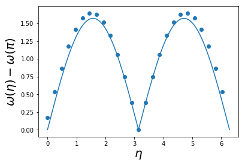
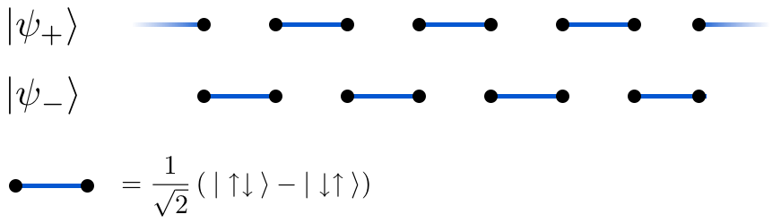
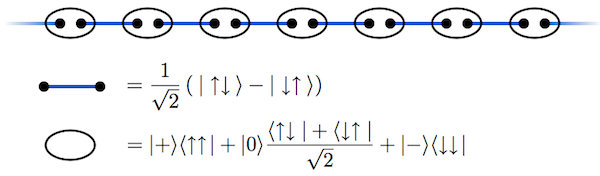

## The OpenAI dump

- 6th October 2026: OpenAI released 719 mathematical preprints

- Included a [proof of the Haldane conjecture](https://github.com/openai/math/blob/main/preprints/The-periodic-spin-one-Haldane-gap-September-24-2026/paper.pdf):

> Antiferromagnetic ($J>0$) Heisenberg chain is _gapless_ for half integer spin and gapped for integer spin

- OpenAI result concerns the spin-1 case. It was already established that the half integer spin chains are gapless

- This lecture: background and significance of the problem, and why it is hard

- This is _mathematical physics_, meaning that we are talking about rigour

- I won't have much to say about the proof itself: see [Hal Tasaki's commentary](https://haltasaki.github.io/writings/AI/OpenAI_Haldane.html) 

## The model

- Recall from [spin models](../notes/spin-models.qmd)
$$
H = J \sum_{j=1}^N \mathbf{s}_j \cdot \mathbf{s}_{j+1}
$$

- Define the _energy gap_
$$
\gamma_L = E_1(L) - E_0(L)
$$

- $E_0(L)$ is gs energy of chain of length $L$ and $E_1(L)$ is next distinct energy

$$
\Delta_1 = \liminf_{\substack{L \to \infty \\ L \text{ even}}} \gamma_L
$$

- If $\Delta_1 > 0$ system is _gapped_; otherwise _gapless_

## Reminder: spin-1/2 chain

- Holstein--Primakoff treatment gave dispersion relation for $J>0$

$$
\omega_{\text{AFM}}(\eta) = 2sJ\left|\sin(\eta)\right|
$$

- Compare with exact result

$$
\omega_{\text{dCP}}(\eta) = \frac{\pi J}{2}\left|\sin(\eta)\right|
$$ 

{fig-align="center"}

## Majumdar--Ghosh model

- Another possibility: ground state can be degenerate

- [Majumdar--Ghosh model](https://en.wikipedia.org/wiki/Majumdar%E2%80%93Ghosh_model)

$$
H_\text{MG} = J \sum_{j=1}^N \mathbf{s}_j \cdot \mathbf{s}_{j+1} + \frac{J}{2} \sum_{j=1}^N \mathbf{s}_j \cdot \mathbf{s}_{j+2}
$$

- Couplings chosen carefully so that (up to an overall constant)

$$
H_\text{MG} = \frac{J}{4} \sum_{j=1}^N \left[\mathbf{s}_{j-1} + \mathbf{s}_{j} + \mathbf{s}_{j+1}\right]^2
$$

---

$$
H_\text{MG} = \frac{J}{4} \sum_{j=1}^N \left[\mathbf{s}_{j-1} + \mathbf{s}_{j} + \mathbf{s}_{j+1}\right]^2
$$

- Each term involves sum of three spins

- By the usual AM addition rules, the spin quantum number is 3/2 or 1/2

- Lowest when any three consecutive spins add to make $S=1/2$

- Put two spins in a singlet: two linearly independent ways to do this

::: {#fig-mg-state}

:::

## Lieb--Schultz--Mattis (LSM) theorem

> For half-integer spin: _a translationally invariant half-integer spin chain cannot have a unique ground state with a gap_

- Either have a gap and a degenerate ground state (MG model) or a unique ground state and no gap (Heisenberg)

- Version due to @affleck1986proof (see 2019 TQM paper)

- Consider Heisenberg chain of $N$ (even) spins and PBC

- Argument only uses translation invariance, short-range interactions, and conservation of $S^z_\text{tot} = \sum_j s^z_j$, so is more general

- Suppose the ground state $\ket{0}$ is unique. It is then a singlet, so $S^z\ket{0}=0$

- $\ket{0}$ is eigenstate of the translation operator $T$, with $T\mathbf{s}_jT^{-1} = \mathbf{s}_{j+1}$

## The twist

$$
U = \exp\left(\frac{2\pi i}{N}\sum_{j=1}^N j\, s^z_j\right)
$$

- Rotates spin on site $j$ about the $z$-axis by an angle $2\pi j/N$

- Neighbouring spins are rotated by $2\pi/N$ relative to each other

$$
U s^\pm_j U^\dagger = e^{\pm 2\pi i j/N}s^\pm_j
$$
(e.g. by Hadamard lemma)

$$
H' = UHU^\dagger = J\sum_{j=1}^N\left[\frac{1}{2}\left(e^{-2\pi i/N}s^+_js^-_{j+1} + e^{2\pi i/N}s^-_js^+_{j+1}\right) + s^z_js^z_{j+1}\right]
$$

## Orthogonality

- Next show that $U^\dagger\ket{0}$ is orthogonal to $\ket{0}$. Translating twist gives

$$
TUT^{-1} = \exp\left(\frac{2\pi i}{N}\sum_{j=1}^N j\, s^z_{j+1}\right) = U\, e^{-2\pi i S^z/N}\, e^{2\pi i s^z_1}
$$

- Here $e^{2\pi i s^z_1}$, a $2\pi$ rotation of a single spin, is $(-1)^{2s}$ times the identity

- Since $\ket{0}$ is translationally invariant and has $S^z=0$

$$
\braket{0|U|0} = \braket{0|TUT^{-1}|0} = (-1)^{2s}\braket{0|U|0}
$$

- For half-integer $s$, it follows that $\braket{0|U|0}=0$

- Equivalently, $U\ket{0}$ has momentum shifted by $\pi$ relative to $\ket{0}$

## Variational bound

- $U^\dagger\ket{0}$ is orthogonal to ground state, so its energy is an upper bound on $E_1$

$$
E_1 - E_0 \leq \braket{0|H'|0} - \braket{0|H|0} 
$$

$$
\braket{0|H'|0} - \braket{0|H|0} = \frac{J}{2}\sum_{j=1}^N\left\langle\left(e^{-2\pi i/N}-1\right)s^+_js^-_{j+1} + \text{h.c.}\right\rangle
$$

- Reflection symmetry $j\to -j$ gives $\langle s^+_js^-_{j+1}\rangle = \langle s^-_js^+_{j+1}\rangle$

- Using translation and spin-rotation invariance

$$
E_1 - E_0 \leq J\left(1-\cos\frac{2\pi}{N}\right)\cdot\frac{2N}{3}|\langle \mathbf{s}_j\cdot\mathbf{s}_{j+1}\rangle| \simeq \frac{4\pi^2 J}{3N}|\langle \mathbf{s}_j\cdot\mathbf{s}_{j+1}\rangle| \to 0
$$

- Argument fails for integer spin: $(-1)^{2s}=+1$

## Affleck--Kennedy--Lieb--Tasaki (AKLT) model

- LSM leaves room for a unique gapped ground state in spin-1 case
$$
H_\text{AKLT} = J \sum_{j=1}^N \mathbf{s}_j \cdot \mathbf{s}_{j+1} + \frac{J}{3} \sum_{j=1}^N \left(\mathbf{s}_j \cdot \mathbf{s}_{j+1}\right)^2
$$

- Up to a constant
$$
H_\text{AKLT} = 2J \sum_{j=1}^N P^{(2)}_{j,j+1}
$$ 

- $P^{(2)}_{j,j+1}$ projects two neighbouring spins on to the subspace of total spin-2

---

::: {.callout-tip}
## Check

Show this. The key is to consider the sum of the two neighbouring spins $\mathbf{s}_j + \mathbf{s}_{j+1}$, which may have $S=2$, $1$, or $0$, so that

$$
\left(\mathbf{s}_j + \mathbf{s}_{j+1}\right)^2 = S(S+1) = 6, 2, 0.
$$

This means that the combination $\left(\mathbf{s}_j + \mathbf{s}_{j+1}\right)^4 - 2\left(\mathbf{s}_j + \mathbf{s}_{j+1}\right)^2$ gives zero on the spin-0 and spin-1 subspaces, projecting onto spin-2.

:::

## AKLT state

- Make spin-1 $\mathbf{s}_j$ on each site from two spin-1/2: $s_{j,L/R}$

- Ground state is constructed in two steps

  1. Create singlets between neighbouring sites: between $\mathbf{s}_{j,R}$ and $\mathbf{s}_{j+1,L}$, and between $\mathbf{s}_{j,L}$ and $\mathbf{s}_{j-1,R}$
  2. Next, project each pair $\mathbf{s}_{j,L/R}$ onto spin-1. 

{fig-align="center"}

---

::: {.callout-tip}
## Check

- Why is this ground state? 

:::

---

## Is it gapped?

- Simple proof of the gap is due to @knabe1988energy, using

  1. $H_\text{AKLT}$ is sum of projectors
  2. It is _frustration free_: the ground state minimizes every term separately

$$
H = \sum_{i=1}^N P_i,\qquad P_i \equiv P^{(2)}_{i,i+1},\qquad P_i^2 = P_i,\qquad H\ket{\Psi}=0
$$

- Strategy is to prove an _operator_ inequality of the form

$$
H^2 \geq \delta H, \qquad \delta>0
$$

- Applied to eigenstate with energy $E$: $E^2\geq \delta E$, so either $E=0$ or $E\geq\delta$

---

$$
H^2 = H + \sum_{d\geq 1} R_d,\qquad R_d = \sum_i \left\{P_i, P_{i+d}\right\}
$$

- For $d\geq 2$ each $P_iP_{i+d}$ is itself a projector, and $R_d\geq 0$

- Problem is $R_1$: need not be positive

- Knabe's idea: control them using a _finite_ open chain

$$
h_j = \sum_{i=j}^{j+m-1} P_i
$$

- Let $\delta_m$ be gap of $h_j$. Lowest eigenvalue is zero by frustration freeness

- We have $h_j^2\geq \delta_m h_j$. Summing over all $N$ windows, $\sum_j h_j = mH$, so

$$
\sum_j h_j^2 \geq m\,\delta_m H
$$

---

- Expand each $h_j^2$ and count how often each term appears

- Each $P_i$ lies in $m$ windows; each pair at distance $d$ in $m-d$ windows. Since $m-d\leq m-1$ and $R_d\geq 0$ for $d\geq 2$

$$
\begin{align*}
\sum_j h_j^2 &= mH + (m-1)R_1 + \sum_{d=2}^{m-1}(m-d)R_d \\
&\leq mH + (m-1)\sum_{d\geq 1}R_d = mH + (m-1)\left(H^2 - H\right)
\end{align*}
$$

- Combining two inequalities gives an operator inequality for the full chain:

$$
H^2 \geq \frac{m\delta_m - 1}{m-1}\, H
$$

---

- Applied to any eigenstate with $E>0$, this gives

$$
\gamma_N \geq \frac{m}{m-1}\left(\delta_m - \frac{1}{m}\right)
$$

- _A gap of the infinite chain follows from a gap on a finite chain_

- All we need is $\delta_m > 1/m$ for some $m$

---

## Exact diagonalization of finite open chains

| sites $m+1$ | $\delta_m$ | $1/m$ | Knabe's bound |
|:-:|:-:|:-:|:-:|
| 3 | 0.500 | 0.500 | 0 |
| 4 | 0.449 | 0.333 | 0.173 |
| 6 | 0.398 | 0.200 | 0.248 |
| 11 | 0.367 | 0.100 | 0.296 |

- Gap of the AKLT chain is at least $0.173$ in units of $2J$, i.e. $\gamma \geq 0.35J$

- Bound improves with $m$ towards the true value $\approx 0.350$ ($\approx 0.70J$)

- Argument works because $H_\text{AKLT}$ is frustration free

- Not true of spin-1 Heisenberg chain, which is why Haldane conjecture needed a very different approach

---