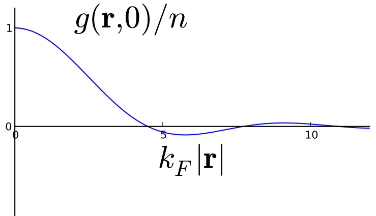



# Second Quantization

- Avoid dealing explicitly with $\Psi(\br_1,\ldots,\br_N)$
- Represent $H$ and other operators using occupation numbers
- Synonymous with Quantum Field Theory

---

## Recap: Product States

- Normalized state of $N$ bosons in orthonormal states $\varphi_{\alpha_n}(\br)$ 

$$
\Psi^{\text{S}}_{\alpha_{1}\alpha_{2}\cdots\alpha_{N}}(\br_1,\ldots,\br_N)=\sqrt{\frac{\prod_{\alpha}N_{\alpha}!}{N!}}\sum_P\varphi_{\alpha_{1}}(\mathbf{r}_{P_1})\varphi_{\alpha_{2}}(\mathbf{r}_{P_2})\cdots\varphi_{\alpha_{N}}(\mathbf{r}_{P_N})
$$

- The normalization factor involves __occupation numbers__ $\{N_{\alpha}\}$ giving number of particles in state $\alpha$

---

- Unnormalized symmetric product state using $\psi_n(\br)$, not necessarily orthonormal

$$
\Psi_\text{prod}^{\text{S}}(\br_1,\ldots,\br_N) = \frac{1}{\sqrt{N!}}\sum_P\psi_1(\mathbf{r}_{P_1})\psi_{2}(\mathbf{r}_{P_2})\cdots\psi_{N}(\mathbf{r}_{P_N})
$$

- Inner product with another symmetric state formed from $\phi_n(\br)$

$$
\Phi_\text{prod}^{\text{S}}(\br_1,\ldots,\br_N) = \frac{1}{\sqrt{N!}}\sum_P\phi_1(\mathbf{r}_{P_1})\phi_{2}(\mathbf{r}_{P_2})\cdots\phi_{N}(\mathbf{r}_{P_N})
$$

$$
\bra{\Psi_\text{prod}}\Phi_\text{prod}\rangle = \sum_P \prod_{n=1}^N\bra{\psi_n}\phi_{P_n}\rangle = \operatorname{perm} \bra{\psi_m}\phi_{n}\rangle
$$

- This is the [permanent](https://en.wikipedia.org/wiki/Permanent) of the matrix $\bra{\psi_m}\phi_{n}\rangle$

---

## Goal 

- For SHO 

$$
\frac{1}{\sqrt{n!}}\left(\adop\right)^n\ket{0}\longleftrightarrow \psi_n(x)
$$
representation using $\aop$, $\adop$ very useful; never need explicit $\psi_n(x)$

- We want 

$$??\longleftrightarrow \Psi^{\text{S}}(\br_1,\ldots,\br_N)$$

- Must respect inner product

---

## Creation & Annihilation Operators

- Regard $N$-particle state as rank $N$ tensor $\Psi_{a_1 a_2 \cdots a_N}$ e.g. in position basis the $N$-body wavefunction is $\Psi(\br_1,\ldots \br_N)$

- $\Psi$ is either symmetric or antisymmetric in the labels $a_i$

$$
\begin{aligned}
\Psi^{\text{S}}_{a_1 a_2 \cdots a_N} &= \Psi^{\text{S}}_{(a_1 a_2 \cdots a_N)}\\
\Psi^{\text{A}}_{a_1 a_2 \cdots a_N} &= \Psi^{\text{A}}_{[a_1 a_2 \cdots a_N]},
\end{aligned}
$$

- Round / square brackets denote symmetrization / antisymmetrization,

$$
T_{(a_1 \cdots a_N)} = \frac{1}{N!}\sum_P T_{a_{P_1}\cdots a_{P_N}},\qquad T_{[a_1 \cdots a_N]} = \frac{1}{N!}\sum_P (-1)^P T_{a_{P_1}\cdots a_{P_N}}
$$

---

## Fock space

- Bosonic / fermionic [Fock space](https://en.wikipedia.org/wiki/Fock_space) consists of states of form

$$
\ket{\Psi}=(\Psi^{\text{S/A}}, \Psi^{\text{S/A}}_{a_1}, \Psi^{\text{S/A}}_{a_1 a_2}, \Psi^{\text{S/A}}_{a_1 a_2 a_3},\ldots).
$$

- Each state a combination of 0-, 1-, 2-, etc, particle states

- 1d space of "no particles" is "vacuum", denoted $\ket{\text{VAC}}$

$$
\inner{\text{VAC}}{\text{VAC}} = 1
$$

- Inner product

$$
\inner{\Psi}{\Phi} = \overline{\Psi}\Phi + \sum_{a_1} \overline{\Psi}_{a_1} \Phi_{a_1}+\sum_{a_1,a_2} \overline{\Psi}_{a_1 a_2} \Phi_{a_1 a_2} + \cdots
$$

---

## Symmetric tensor operations

- Can form symmetric product of two tensors

$$
(\Psi \odot \Phi)_{a_1 a_2 \cdots a_{M + N}} = \Psi_{\left(a_1 a_2 \cdots a_{M}\right.} \Phi_{\left. a_{M+1} a_{M+2} \cdots a_{M + N}\right).}
$$

- Also contract indices to form a lower rank tensor. If $M\leq N$:

$$
(\bar{\Psi} \cdot \Phi)_{a_{M+1} \cdots a_{N}} = \bar{\Psi}_{a_1\cdots a_{M}}\Phi_{a_1 a_2 \cdots a_N},
$$

- Contraction preserves the symmetry of the tensors

---

## Annihilation operator

- Defined by

$$
(\aop(\psi)\Phi)_{a_2\cdots a_{N}} = \sqrt{N}\overline{\psi}_{a_1} \Phi_{a_1\cdots a_{N}}. 
$$

- Extended to general Fock space state by linearity

- Think of the $\aop(\psi)$ as "removing a particle from state $\psi$"

- Inner product fixes adjoint operator $\adop(\psi)$

$$
(\adop(\psi)\Phi)_{a_1\cdots a_{N+1}} = \sqrt{N + 1}\psi_{\left(a_{1}\right.} \Phi_{\left.a_2\cdots a_{N+1}\right)}. 
$$

---

## Commutation relations

- First note that $\aop(\psi)$ and $\aop(\phi)$ commute, as well as $\adop(\psi)$ and $\adop(\phi)$

$$
\begin{aligned}
\left[\adop(\psi),\adop(\phi)\right]&=0\\
\left[\aop(\psi),\aop(\phi)\right]&=0.
\end{aligned}
$$ 

For commutator of $\aop(\psi)$ and $\adop(\phi)$ compute

$$
\begin{aligned}
(\aop(\psi)\adop(\phi)A)_{a_1\cdots a_N} &= (N+1)\overline{\psi}_b \phi_{(b}A_{a_1 \cdots a_N)}\\
(\adop(\phi)\aop(\psi)A)_{a_1\cdots a_N} &= N\overline{\psi}_b\phi_{(a_1} A_{|b| a_2 \cdots a_N)}.
\end{aligned}
$$

- Indices enclosed in vertical bars are excluded

- First expression can be written as

$$
(N+1)\overline{\psi}_b \phi_{(b}A_{a_1 \cdots a_N)} =  \overline{\psi}_b \phi_b A_{a_1\cdots a_N} +  N\overline{\psi}_b\phi_{(a_1} A_{|b| a_2 \cdots a_N)}
$$

---

- This gives the commutation relation

$$
\left[\aop(\psi),\adop(\phi)\right] = \overline{\psi}_b \phi_b = \inner{\psi}{\phi}
$$

::: {.callout-tip}
## Check

The $N$ particle symmetric product state $\ket{\Psi_\text{prod}^{\text{S}}}$ is represented in terms of creation operators as acting on the vacuum state $\ket{\text{VAC}}$ as

$$
\ket{\Psi_\text{prod}^{\text{S}}} = \adop(\psi_1)\cdots \adop(\psi_N)\ket{\text{VAC}}
$$

Show that the commutation relations reproduce the correct inner product.

:::

## Choosing a basis

- Orthonormal basis by $\varphi_\alpha(\br)$

$$
\adop(\varphi_\alpha)\equiv \adop_\alpha,\quad \aop(\varphi_\alpha)\equiv \aop_\alpha
$$

- Then we have

$$
\begin{aligned}
\left[\aop_\alpha,\aop_\beta\right]=0,\quad \left[\adop_\alpha,\adop_\beta\right]=0,\quad \left[\aop_\alpha,\adop_\beta\right] = \delta_{\alpha\beta}
\end{aligned}
$$

- Same as ladder operators of a set of harmonic oscillators

$$
\Psi^{\text{S}}_{\alpha_{1}\alpha_{2}\cdots\alpha_{N}}(\br_1,\ldots,\br_N) \longleftrightarrow\ket{\mathbf{N}} \equiv \prod_\alpha \frac{\left(\adop_\alpha\right)^{N_\alpha}}{\sqrt{N_\alpha!}}\ket{\text{VAC}}
$$

---

- $\Nop_{\alpha}\equiv \adop_{\alpha}\aop_{\alpha}$ is __number operator__ for state $\alpha$

$$
\Nop_{\alpha}\ket{\mathbf{N}}=N_{\alpha}\ket{\mathbf{N}}
$$

- Commutation relations tell us

$$
\begin{aligned}
	\left[\aop_{\alpha},\Nop_{\alpha}\right]=\aop_{\alpha}\qquad
	\left[\adop_{\alpha},\Nop_{\alpha}\right]=-\adop_{\alpha}
\end{aligned}
$$

- I think of the first one as: 

> "count then destroy minus destroy then count"

---

## Change of basis

- Move to different basis $\{\ket{\tilde{\varphi}_{\alpha}}\}$

$$
\ket{\tilde{\varphi}_{\alpha}}=\sum_{\beta} \inner{\varphi_{\beta}}{\tilde{\varphi}_{\alpha}}\ket{\varphi_{\beta}}
$$

- One particle states with wavefunctions $\varphi_{\alpha}(\br)$ are $\adop_{\alpha}\ket{\text{VAC}}$. So,

$$
\tilde{\aop}_{\alpha}^\dagger\equiv\sum_{\beta} \inner{\varphi_{\beta}}{\tilde{\varphi}_{\alpha}}\adop_{\beta}
$$

---

- Often we work in position eigenstates $\{\ket{\br}\}$, so $\inner{\varphi_{\beta}}{\br}=\varphi^{*}_{\beta}(\br)$

- Denoting corresponding creation operator as $\pdop(\br)$

$$
\pdop(\br)\equiv\sum_{\beta}  \varphi^{*}_{\beta}(\br)\adop_{\beta}
$$

- Conjugate is

$$
\pop(\br)\equiv\sum_{\beta}  \varphi_{\beta}(\br)\aop_{\beta}
$$

---

- These are __quantum fields__ with commutation relations

$$
\begin{gather*}
	\left[\pop(\br_1),\pdop(\br_2)\right]=\delta(\br_1-\br_2)\nonumber\\
	\left[\pop(\br_1),\pop(\br_2)\right]=\left[\pdop(\br_1),\pdop(\br_2)\right]=0
\end{gather*}
$$

::: {.callout-tip}
## Check

If a state $\ket{\Psi}$ has wavefunction $\Psi(x_1,\ldots, x_N)$, show that the wavefunction of the state $\pop(X)\ket{\Psi}$ is the $N-1$ particle wavefunction

$$
\sqrt{N}\Psi(X,x_1,\ldots, x_{N-1})
$$

Hint: Show that this is true for a product state first.

:::

---

- Often use eigenstates of the free particle Hamiltonian $H=\frac{\bp^{2}}{2m}$ 
$$
\begin{aligned}
	\ket{\bk}=\frac{\exp(i\bk \cdot \br)}{\sqrt{V}}, \quad \bk=2\pi\left(\frac{n_{x}}{L_{x}},\frac{n_{y}}{L_{y}},\frac{n_{z}}{L_{z}}\right),\quad n_{x,y,z}\text{ integer},
\end{aligned}
$$
with $V=L_{x}L_{y}L_{z}$ (periodic b.c.)

- Matrix elements of transformation between to position basis $\{\ket{\br}\}$ are $\bra{\bk}\br\rangle=\exp(-i\bk \cdot \br)/\sqrt{V}$
$$
\pdop(\br)\equiv\frac{1}{\sqrt{V}}\sum_{\bk} \exp(-i\bk\cdot\br)\adop_{\bk}
$$
and similarly
$$
	\pop(\br)\equiv\frac{1}{\sqrt{V}}\sum_{\bk} \exp(i\bk\cdot\br)\aop_{\bk}
$$

---

::: {.callout-tip}
## Check

What is the wavefunction of the two-particle state

$$
\sum_\bk c_\bk \adop_\bk\adop_{-\bk}\ket{\text{VAC}}?
$$

:::

---

## Fermions

- Trickier on account of minus signs! Seek a representation of

$$
\Psi^{\text{A}}(\br_1,\ldots,\br_N) = \frac{1}{\sqrt{N!}}\sum_P (-1)^P\psi_1(\mathbf{r}_{P_1})\psi_{2}(\mathbf{r}_{P_2})\cdots\psi_{N}(\mathbf{r}_{P_N})
$$

Note: overall sign fixed by labelling of states $\psi_j$

- If $\Psi^{\text{A}}(\br_1,\ldots,\br_N) \longleftrightarrow \adop(\psi_1)\cdots \adop(\psi_N)\ket{\text{VAC}}$ we'll need

$$
\left\{\adop(\psi),\adop(\phi)\right\}=0,
$$
$\{A,B\}\equiv AB+BA$ is __anticommutator__. Also

$$
\left\{\aop(\psi),\aop(\phi)\right\}=0
$$

---

- $\left\{\aop(\psi),\adop(\phi)\right\}$ can be deduced from inner product

$$
\bra{\Psi}\Phi\rangle = \sum_P (-1)^P\prod_{n=1}^N\bra{\psi_n}\phi_{P_n}\rangle = \det \bra{\psi_m}\phi_{n}\rangle,
$$

which works out if

$$
\left\{\aop(\psi),\adop(\phi)\right\} = \inner{\psi}{\phi}
$$

::: {.callout-tip}
## Check

Check this.

:::

---

- Introducing field operators in position basis as before leads to

$$
\begin{gather*}
	\left\{\pop(\br_1),\pdop(\br_2)\right\}=\delta(\br_1-\br_2)\nonumber\\
	\left\{\pop(\br_1),\pop(\br_2)\right\}=\left\{\pdop(\br_1),\pdop(\br_2)\right\}=0
\end{gather*}
$$

---

## How do $\aop_\alpha$ and $\adop_\alpha$ _look_?

::: {.callout-tip}
## Check

Think about the form that the operators $\aop_\alpha$, $\adop_\alpha$ take in the basis of product states. Start with one state $\varphi_\alpha$. What's the matrix form of $\adop_\alpha$ in terms of states $\ket{N_\alpha}$? Now consider two states. Can you see how the commutation and anticommutation relations can be satisfied?

:::

---

## One Particle Operators

- Notation: $A$ acts on single particle states; $\hat A$ acts on $N$ particles as

$$
\hat A = \sum_{j=1}^N A_j
$$

- Example: Hamiltonian for noninteracting particles

$$
\hat H = \sum_{j=1}^N H_j = \sum_{j=1}^N \left[-\frac{\nabla_j^2}{2m}+V(\br_j)\right]
$$

- Operators of this type are __one particle operators__

- How to represent them using creation and annihilation operators?

---

- We show that the one-particle operator $\hat A$ has representation

$$
\hat A = \int \pdop(x_1) [A_{x_1} \pop({x_1})]\, d{x_1}
$$

- Evaluate matrix element $\ket{\Psi}$ and $\ket{\Phi}$

$$
\begin{aligned}
\braket{\Psi}{\hat A}{\Phi} &=  \int \braket{\Psi}{\pdop(x_1) [A_{x_1} \pop(x_1)]}{\Phi}\, dx_1 \\ 
&= N \int \Psi^*(x_1,x_2,\ldots x_{N})\left[A_{x_1} \Phi(x_1,x_2,\dots x_{N})\right]dx_1 dx_2\ldots dx_{N}\\ 
&=\sum_{j=1}^N  \int  \Psi^*(x_1,x_2,\ldots x_{N})\left[A_{x_j} \Phi(x_1,x_2,\dots x_{N})\right]dx_1 dx_2\ldots dx_{N}.
\end{aligned}
$$

- Any sign in the fermionic case is squared and therefore has no effect.

---

$$
\hat A = \int \pdop(x_1) [A_{x_1} \pop({x_1})]\, d{x_1}
$$

- Substitute $\pop(\br)\equiv\frac{1}{\sqrt{V}}\sum_{\bk} \exp(i\bk\cdot\br)\aop_{\bk}$
$$
\hat A = \sum_{\alpha\beta}A_{\alpha\beta}\adop_\alpha\aop_\beta
$$
where $A_{\alpha\beta}=\braket{\varphi_\alpha}{A}{\varphi_\beta}$ are matrix elements

- Like _expectation value_ of $\mathop{A}$ in single particle state $\sum_{\alpha}a_{\alpha}\ket{\varphi_{\alpha}}$

- But $a_\alpha$ are _operators_ not _numbers_. This is the origin of the name __second quantization__

- Resemblance makes it easy to write down second quantized form

---

$$
\hat A = \sum_{\alpha\beta}A_{\alpha\beta}\adop_\alpha\aop_\beta
$$

- Matrix element $\braket{\mathbf{N}}{\hat A}{\mathbf{N'}}$ vanishes unless $\mathbf{N}$ and $\mathbf{N'}$ differ by the movement of of one particle

- If $N_\beta = N'_\beta-1$ and $N_\alpha = N'_\alpha+1$ we have

$$
\braket{\mathbf{N}}{\hat A}{\mathbf{N'}} = A_{\alpha\beta} \sqrt{N_\alpha N'_\beta}.
$$ 

::: {.callout-tip}
## Check

This formula is not so easy to work out in the first quantized representation. Try it!

:::

---

### Example 1: noninteracting Hamiltonian

$$
\hat H = \sum_{j=1}^N H_j = \sum_{j=1}^N \left[-\frac{\nabla_j^2}{2m}+V(\br_j)\right]
$$

- Second quantized form
$$
	\mathop{\hat H} \equiv \sum_{\alpha,\beta}\braket{\varphi_{\alpha}}{\mathop{H}}{\varphi_{\beta}} \adop_{\alpha}\aop_{\beta},
$$
$H$ is single particle Hamiltonian $H=-\frac{1}{2m}\nabla_{i}^{2}+V(\mathbf{r_{i}})$

- If basis $\ket{\varphi_{\alpha}}$ is eigenbasis of $H$: $\braket{\varphi_{\alpha}}{\mathop{H}}{\varphi_{\beta}}=E_{\alpha}\delta_{\alpha \beta}$ and

$$
\begin{aligned}
	\mathop{\hat H} \equiv \sum_{\alpha} E_{\alpha} \adop_{\alpha}\aop_{\alpha}=\sum_{\alpha} E_{\alpha} \Nop_{\alpha}
\end{aligned}
$$

---

- In the position basis

$$
\begin{aligned}
	\mathop{\hat H}&=\int d\br \left[-\frac{1}{2m}\pdop(\br)\nabla^{2}\pop(\br)+V(\br)\pdop(\br)\pop(\br)\right]\nonumber\\
					&=\int d\br \left[\frac{1}{2m}\nabla\pdop(\br)\cdot\nabla\pop(\br)+V(\br)\pdop(\br)\pop(\br)\right],
\end{aligned}
$$
(integration by parts)

- Confirm equality to previous expression using

$$
	\pop(\br)\equiv\sum_{\beta}  \varphi_{\beta}(\br)\aop_{\beta}
$$

---

- Heisenberg equation of motion for $\pop(\br,t)=e^{i\hat Ht}\pop(\br) e^{-i\hat H t}$ with noninteracting Hamiltonian

$$
	\begin{split}
	i\partial_{t}\pop(\br,t) &= -\left[\mathop{\hat H},\pop(\br,t)\right]\\
	&= -\frac{1}{2m}\nabla^{2}\pop(\br,t)+V(\br)\pop(\br,t)
	\end{split}
$$
just the time dependent Schrödinger equation!

--- 

### Example 2: Density

- One particle operator for density at $\mathbf{x}$ is

$$
	\rho(\mathbf{x})\equiv\delta(\mathbf{x}-\br)
$$

- Expectation value in single particle state $\varphi(\br)$ is $\rho(\mathbf{x})=\abs{\varphi(\mathbf{x})}^{2}$

- Second quantized form of the operator is then

$$
	\hat\rho(\mathbf{x})\equiv\pdop(\mathbf{x})\pop(\mathbf{x})
$$

- __Check:__ integrating over position should give total number of particles

$$
	\hat N=\int d\mathbf{x}\, \pdop(\mathbf{x})\pop(\mathbf{x})=\sum_{\alpha} \adop_{\alpha}\aop_{a}=\sum_{\alpha}\Nop_{\alpha}
$$

---

- Expectation value of density in product state $\ket{N_{0},N_{1}\ldots}$

$$
	\braket{N_{0},N_{1}\ldots}{ \hat\rho(\br)}{N_{0},N_{1}\ldots} = \sum_{\alpha} N_{\alpha}\left|\varphi_{\alpha}(\br)\right|^{2}
$$

::: {.callout-tip}
## Check

Prove using $\pop(\br)\equiv\sum_{\beta}  \varphi_{\beta}(\br)\aop_{\beta}$

:::

- Interpretation: $\left|\varphi_{\alpha}(\br)\right|^{2}$ is probability to find a particle in state $\alpha$ at position $\br$

- Density is weighted by occupation

---

### Example 3: Current operator

$$
	\hat{\mathbf{j}}(\br)=-i\frac{1}{2m}\left[\pdop(\br)\left(\nabla\pop(\br)\right)-\left(\nabla\pdop(\br)\right)\pop(\br)\right].
$$

- Often we consider Fourier components of density or current

$$
\begin{aligned}
	\hat\rho_{\bq}\equiv\int d\br\, \hat\rho(\br)e^{-i\bq \cdot \br}=\sum_{\bk} \adop_{\bk-\bq}\aop_{\bk}\nonumber\\
	\hat{\mathbf{j}}_{\bq}\equiv\int d\br\, \hat{\mathbf{j}}(\br)e^{-i\bq \cdot \br}=\frac{1}{m}\sum_{\bk} (\bk-\bq/2)\adop_{\bk-\bq}\aop_{\bk}
\end{aligned}
$$

- $\bq=0$ modes are total particle number and $\frac{1}{m}\times$ total momentum, respectively

---

### Single particle density matrix

- From [Lecture 1](../notes/many-body-wavefunctions.qmd) 

$$
	g(\br,\br') \equiv N \int d\br_{2}\cdots d\br_{N}\,\Psi^{*}(\br,\br_{2},\ldots,\br_{N})\Psi(\br',\br_{2},\ldots,\br_{N}).
$$

::: {.callout-tip}
## Check

Show that this can be written as

$$
g(\br,\br')= \braket{\Psi}{\pdop(\br)\pop(\br')}{\Psi}
$$

:::

- Similar calculation as for density gives

$$
	g(\br,\br') = \sum_{\alpha} N_{\alpha}\varphi_{\alpha}^{*}(\br)\varphi^{}_{\alpha}(\br')
$$

---

- For 3D $N_{\bk}=1$ for $\abs{\bk}<k_{F}$, and $0$ otherwise

$$
\ket{\text{Fermi sea}} = \prod_{|\bk|<k_F} \adop_\bk\ket{\text{VAC}}
$$

::: {.callout-tip}
## Check
$$
\begin{aligned}
	g(\br,\br')&=\frac{1}{V}\sum_{|\bk|<k_{F}} e^{i\bk\cdot(\br'-\br)}=\int_{|\bk|<k_{F}} \frac{d\bk}{(2\pi)^{3}}\,e^{i\bk\cdot(\br'-\br)}\nonumber\\
	&=\frac{k_{F}^{3}}{2\pi^{2}}\left[\frac{\sin\left(k_{F}|\br'-\br|\right)}{(k_{F}|\br'-\br|)^{3}}-\frac{\cos\left(k_{F}|\br'-\br|\right)}{(k_{F}|\br'-\br|)^{2}}\right].
\end{aligned}
$$

Note that $g(\br,\br)=\frac{k_{F}^{3}}{6\pi^{2}}=n$

:::

- c.f. earlier calculation in 1D using Slater determinant

---

{width=60% fig-align="center"}

---

## Two Particle Operators

- Acts _pairwise_ on the particles ($B_{jk}=B_{kj}$ for indistinguishable particles.) 

$$
\hat B = \sum_{j<k} B_{jk}.
$$

- Has representation

$$
\hat B =\frac{1}{2} \int \pdop(x_1)\pdop(x_2) [B_{x_1,x_2} \pop(x_2)\pop(x_1)]\, dx_1 dx_2,
$$
where $B_{x_1,x_2}$ is an operator that acts on a pair of wavefunctions

---

- Taking matrix elements yields

$$
\begin{aligned}
\braket{\Psi}{\hat B}{\Phi} &= \frac{1}{2} \int \braket{\Psi}{\pdop(x_1)\pdop(x_2) [B_{x_1,x_2} \pop(x_2)\pop(x_1)]}{\Phi}\, dx_1 dx_2\\
 &= \frac{1}{2}N(N-1) \int \Psi^*(x_1,x_2,\ldots x_{N})\left[B_{x_1,x_2} \Phi(x_1,x_2,\dots x_{N})\right]dx_1 dx_2\ldots dx_{N}\\ 
&=\sum_{j<k}  \int  \Psi^*(x_1,x_2,\ldots x_{N})\left[B_{x_j,x_k} \Phi(x_1,x_2,\dots x_{N})\right]dx_1 dx_2\ldots dx_{N}.
\end{aligned}
$$

- All terms in sum over pairs are identical by (anti-)symmetry of the wavefunctions

---

- Remember that for one particle operators

$$
\braket{\mathbf{N}}{\hat A}{\mathbf{N'}} = A_{\alpha\beta} \sqrt{N_\alpha N'_\beta}
$$

- For two particle operators 

$$
\braket{\mathbf{N}}{\hat B}{\mathbf{N'}} =  \left[B_{\alpha\beta,\gamma\delta}\pm B_{\alpha\beta,\delta\gamma}\right] \sqrt{N_\alpha N_\beta N'_\gamma N'_\delta}
$$
with $N_{\gamma,\delta} = N'_{\gamma,\delta}-1$ and $N_{\alpha,\beta} = N'_{\alpha,\beta}+1$

- For fermions the overall sign depends on convention: best to write states explicitly rather than matrix elements

---

$$
\braket{\mathbf{N}}{\hat B}{\mathbf{N'}} =  \left[B_{\alpha\beta,\gamma\delta}\pm B_{\alpha\beta,\delta\gamma}\right] \sqrt{N_\alpha N_\beta N'_\gamma N'_\delta}.
$$

- Strictly we have

$$
\begin{gather*}
N'_\gamma N'_\delta \to N'_\gamma (N'_\gamma-1) && \gamma=\delta\\
N_\alpha N_\beta \to N_\alpha (N_\alpha-1) && \alpha=\beta
\end{gather*}
$$
In thermodynamic limit these terms usually make a vanishing contribution when sums replaced with integrals

- Exceptions: when a finite fraction of particles are in one state (which occurs for Bose—Einstein condensates). In those cases we end up neglecting $N_\alpha-1$ relative to $N_\alpha$, however!

---

### Example: pairwise interaction

$$
\hat H_\text{int.} = \sum_{j<k} U(\br_j-\br_k).
$$

- Expressing in position basis

$$
\hat H_\text{int.} = \frac{1}{2}\int d\br_1 d\br_2\, U(\br_1-\br_2)\pdop(\br_1)\pdop(\br_2)\pop(\br_2)\pop(\br_1)
$$

- Remembering that $\rho(\br) = \pdop(\br)\pop(\br)$, this is _almost_

$$
\frac{1}{2}\int d\br_1 d\br_2\, U(\br_1-\br_2)\rho(\br_1)\rho(\br_2)
$$
Operator order prevents a particle from interacting with itself!

---

$$
\hat H_\text{int.} = \frac{1}{2}\int d\br_1 d\br_2\, U(\br_1-\br_2)\pdop(\br_1)\pdop(\br_2)\pop(\br_2)\pop(\br_1)
$$

::: {.callout-tip}
## Check

$\hat H_\text{int}$ has zero expectation for 1 particle

:::

---

- Hamiltonian of interacting bosons from [Lecture 1](../notes/many-body-wavefunctions.qmd)

$$
H = -\frac{1}{2m}\sum_j \frac{\partial^2}{\partial x_j^2} + \overbrace{c\sum_{j<k}\delta(x_j-x_k)}^{\equiv H_\text{int}}.
$$
has second quantized form
$$
H = \int dx \left[\frac{1}{2}\partial_x\pdop(x)\partial_x\pop(x) + \frac{c}{2}\pdop(x)\pdop(x)\pop(x)\pop(x)\right]
$$
$\pop(x)$, $\pdop(x)$ satisfy the canonical bosonic commutation relations

::: {.callout-warning appearance="minimal"}

__QFT is a language__, but writing something in a new way doesn't (necessarily) make it easier to solve!

:::
